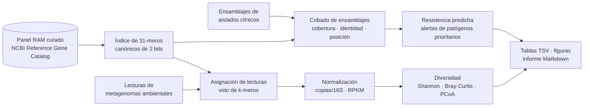

<div align="center">

# resistoscan

**Vigilancia de genes de resistencia a antimicrobianos sin alineamiento, del hospital al río.**
Un pipeline bioinformático One Health en Python para aislados clínicos y metagenomas ambientales.

[](https://github.com/aespejolobo-rgb/resistoscan/actions/workflows/tests.yml)


[English](README.md) · **Español**

</div>

---

## Motivación

La resistencia a los antimicrobianos (RAM) causó directamente unas **1,27 millones de muertes en 2019**
(Murray *et al.*, *Lancet* 2022). Los genes de resistencia no se quedan en el hospital: viajan en plásmidos e
integrones a través de los efluentes hospitalarios, las estaciones depuradoras de aguas residuales (EDAR), los ríos
y los suelos agrícolas, donde pueden volver a pasar a patógenos humanos y animales. Seguirlos a través de estos
compartimentos es la idea central del enfoque **One Health** («Una sola salud»), y la metagenómica de aguas
residuales es hoy una herramienta de vigilancia consolidada (Hendriksen *et al.*, *Nat Commun* 2019).

`resistoscan` responde a dos preguntas prácticas con un mismo motor:

| | **Flujo clínico** | **Flujo ambiental** |
|---|---|---|
| Entrada | Genomas ensamblados de aislados bacterianos (FASTA) | Lecturas metagenómicas *shotgun* (FASTQ/FASTA, gz) |
| Pregunta | *¿Qué genes de resistencia porta este aislado, dónde, y corresponde a un genotipo de patógeno prioritario?* | *¿Cuán abundantes y diversos son los genes de resistencia en esta muestra y cómo se comparan los sitios?* |
| Salida | Genes detectados con cobertura, identidad, estimación de SNP, coordenadas en el contig y hebra; clases de antibióticos con resistencia predicha; alertas de carbapenemasas, BLEE, SARM, ERV y *mcr* | Copias por gen 16S rRNA y RPKM por gen, diversidad alfa, disimilitud de Bray-Curtis, PCoA, figuras e informe en Markdown |

## Puntos clave

- **Datos de referencia reales.** Un panel curado de 18 genes de resistencia (ARG) de relevancia clínica y
  ambiental, tomados del [NCBI Reference Gene Catalog](https://www.ncbi.nlm.nih.gov/pathogens/refgene/), más la
  integrasa de integrones de clase 1 *intI1* (indicador de contaminación antropogénica) y el gen 16S rRNA para
  normalizar. El panel se reconstruye de forma reproducible con
  [`scripts/build_reference_panel.py`](scripts/build_reference_panel.py).
- **Sin alineamiento y rápido.** K-meros canónicos de 31 nt codificados en enteros de 64 bits, un índice de
  arreglo ordenado consultado con búsqueda binaria vectorizada y procesamiento de lecturas por lotes: unas
  15 000 lecturas/s en un solo núcleo de portátil, solo con NumPy, pandas y matplotlib.
- **Resultados con sentido biológico.** Abundancias en copias por gen 16S rRNA (la unidad estándar en estudios
  de resistoma), identidad estimada a partir de la contención de k-meros (modelo de Mash), número de SNP,
  detección de genes parciales y alertas genotipo-fenotipo.
- **Validado.** Un simulador integrado genera un conjunto de datos One Health con verdad conocida, y
  `resistoscan demo` evalúa el pipeline frente a ella: detección, cuantificación y localización de genes.
- **Construido como una herramienta real.** Paquete instalable con interfaz de línea de comandos, 22 pruebas
  unitarias y de integración, integración continua en GitHub Actions y código tipado y documentado.

## Cómo funciona



1. **Índice**: cada gen de referencia se divide en 31-meros solapados. Cada k-mero se guarda en forma canónica
   (el menor entre él y su complementario inverso), así la búsqueda no depende de la hebra secuenciada.
2. **Lecturas**: cada lectura se asigna al gen con el que comparte más k-meros, si comparte al menos 10 y estos
   cubren al menos el 25 % del tramo coincidente (≈ 95,6 % de identidad nucleotídica). Se acumulan la profundidad
   y la amplitud de cobertura por gen, y un gen se considera detectado si se cubre ≥ 50 % de su longitud.
3. **Ensamblajes**: la fracción de k-meros del gen presentes en los contigs da la amplitud de cobertura y una
   estimación de identidad (identidad ≈ contención<sup>1/k</sup>); los k-meros ausentes permiten estimar SNP;
   las posiciones de los k-meros dan las coordenadas y la hebra en el contig.
4. **Normalización y ecología**: copias por gen 16S rRNA, RPKM, índices de Shannon, Gini-Simpson y Pielou,
   disimilitud de Bray-Curtis y Análisis de Coordenadas Principales, implementados desde cero.

Las derivaciones completas están en [docs/METHODS.md](docs/METHODS.md) (en inglés).

## Inicio rápido

```bash
git clone https://github.com/aespejolobo-rgb/resistoscan.git
cd resistoscan
python -m venv .venv
source .venv/bin/activate        # Windows: .venv\Scripts\activate
pip install -e ".[dev]"

resistoscan demo -o demo         # simula datos, ejecuta ambos flujos, valida y genera un informe (~30 s)
pytest                           # ejecuta las pruebas
```

El informe se guarda en `demo/results/report.md`. Hay una copia de una ejecución completa en
[docs/example_report.md](docs/example_report.md).

## Resultados en un conjunto de datos One Health simulado

> **Nota.** Estos resultados proceden de datos *simulados* con `resistoscan simulate`: genes de referencia reales,
> genomas de fondo sintéticos y lecturas tipo Illumina de 150 pb con un 0,5 % de error de secuenciación. Las
> abundancias son órdenes de magnitud ilustrativos inspirados en tendencias publicadas, no mediciones de sitios
> reales. Sirven para mostrar qué recupera el pipeline cuando se conoce la verdad.

El escenario sigue los genes de resistencia a lo largo de una ruta de aguas residuales (efluente hospitalario →
entrada de la EDAR → salida de la EDAR → río aguas abajo), con un tramo de río aguas arriba como referencia y un
suelo agrícola abonado con estiércol como segunda ruta, de origen veterinario.


<p align="center"></p>

Lo que recupera el pipeline:

- **El efluente hospitalario** tiene la mayor carga (2,68 copias de ARG por 16S) y es el único sitio donde se
  detectan las cuatro carbapenemasas (*blaKPC-2*, *blaNDM-1*, *blaOXA-48*, *blaVIM-2*), junto con *mecA* y *vanA*.
- **La depuración** reduce la carga total unas 4,5 veces (2,35 → 0,52), pero *sul1*, *intI1* y los genes de
  tetraciclinas y macrólidos persisten en el efluente.
- **El río aguas abajo** del vertido tiene unas 12 veces más carga que aguas arriba (0,27 frente a 0,02) y se
  agrupa con el efluente de la EDAR en la ordenación.
- **El suelo abonado con estiércol** tiene un resistoma dominado por tetraciclinas y es el único sitio con
  *mcr-1* (resistencia móvil a colistina), lo que apunta a la ruta agrícola.
- Un **gen divergente similar a OXA-48** (88 % de identidad, como los progenitores cromosómicos de *Shewanella*
  spp.) en el río aguas arriba **no** se notifica, correctamente, como el alelo clínico *blaOXA-48*.

### Aislados clínicos

| Aislado | Genes de resistencia detectados | Alertas |
|---|---|---|
| *K. pneumoniae* ISO-01 | *aac(6')-Ib-cr5, blaCTX-M-15, blaKPC-2, blaTEM-1, dfrA1, qnrS1, sul1* | Carbapenemasa (*blaKPC-2*, 1 SNP respecto a la referencia); BLEE (*blaCTX-M-15*) |
| *S. aureus* ISO-02 | *mecA, tet(M)* | Genotipo SARM |
| *E. faecium* ISO-03 | *erm(B), tet(M), vanA* | Genotipo ERV |
| *E. coli* ISO-04 | *blaCTX-M-15, mcr-1.1, sul2, tet(A)* | BLEE; resistencia móvil a colistina. *blaOXA-48* truncado marcado como parcial |

### Validación frente a la verdad simulada

<table>
<tr><td valign="top">

| Metagenomas | |
|---|---|
| Especificidad | **1,00** (0 falsos positivos en 44 pares ausentes) |
| Sensibilidad, genes ≥ 0,02 copias/16S | **0,93** |
| Sensibilidad, todos los genes presentes | 0,84 (los fallos están en el límite de detección) |
| *r* de Pearson, log<sub>10</sub> abundancia | **0,98** |
| Error mediano (veces) | **1,10** |
| Señuelo divergente detectado por error | 0 / 1 |

| Aislados | |
|---|---|
| Precisión / sensibilidad | **1,00 / 1,00** (17 genes) |
| Coordenadas y hebra exactas | 17 / 17 |
| Número de SNP exacto | 17 / 17 |
| Gen truncado marcado | 1 / 1 |

</td><td valign="top">


</td></tr>
</table>

## Uso con datos propios

**Metagenomas**: una hoja de muestras separada por tabuladores. Las rutas son relativas a la hoja; los archivos
pareados se separan con comas.

```text
sample      group          description        reads
HOSP_EFF    Wastewater     Hospital effluent  reads/hosp_R1.fastq.gz,reads/hosp_R2.fastq.gz
RIVER_UP    Surface water  River upstream     reads/river_up.fastq.gz
```

```bash
resistoscan metagenome samples.tsv -o resultados_metagenomas
```

**Aislados**: una hoja con un ensamblaje por aislado.

```text
isolate     organism                assembly
KP-0231     Klebsiella pneumoniae   assemblies/KP-0231.fasta
```

```bash
resistoscan isolate isolates.tsv -o resultados_aislados
```

**Bases de datos propias**: cualquier FASTA de nucleótidos con una tabla TSV de anotación con las columnas
`gene`, `category` (`ARG`, `MGE` o `marker`) y `display_class` puede sustituir al panel incluido:
`--db mis_genes.fasta --metadata mis_genes.tsv`. `resistoscan panel` lista los genes incluidos.

## Decisiones de diseño y limitaciones

- **La búsqueda exacta de k-meros es específica de alelo.** No detecta genes con menos de ~95 % de identidad
  nucleotídica con una referencia. Es adecuado para vigilar alelos clínicos conocidos, pero los homólogos lejanos
  requieren búsqueda a nivel de proteína (p. ej. DIAMOND contra CARD o la base completa de NCBI).
- **Panel curado.** 18 ARG, en la línea de los arrays de qPCR de alto rendimiento. El motor acepta cualquier base
  de datos, pero las muy redundantes se beneficiarían de un paso de maximización de la esperanza (EM) para repartir
  lecturas multimapeadas (como hace KMA); está en la hoja de ruta.
- **La normalización por 16S** usa una sola secuencia 16S de *E. coli*. En comunidades reales hace falta una base
  de 16S (o genes marcadores de copia única) para contar todos los taxones.
- **Genotipo no es fenotipo.** No se modelan mutaciones puntuales (p. ej. *gyrA*, pérdida de porinas) ni la
  expresión. Las predicciones deben confirmarse con antibiograma.
- **La validación simulada** demuestra que los algoritmos son correctos, no su rendimiento en campo. El siguiente
  paso es un conjunto de datos real, como metagenomas públicos de aguas residuales del European Nucleotide Archive.

## Hoja de ruta

- [ ] Redistribución por EM de lecturas multimapeadas para bases redundantes (NCBI completo / CARD)
- [ ] Genes marcadores de copia única como normalización alternativa
- [ ] Caso de estudio con metagenomas públicos de aguas residuales (ENA)
- [ ] Contexto plasmídico o cromosómico de los ARG en ensamblajes
- [ ] Flujo de trabajo en Snakemake e imagen Docker

## Referencias

Ver la lista completa en el [README en inglés](README.md#references).

## Autor

**aespejolobo-rgb** · [GitHub](https://github.com/aespejolobo-rgb)

Publicado bajo la [licencia MIT](LICENSE). Solo para investigación y docencia; no apto para diagnóstico clínico.
