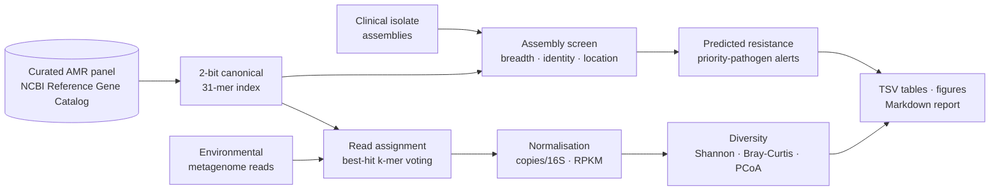
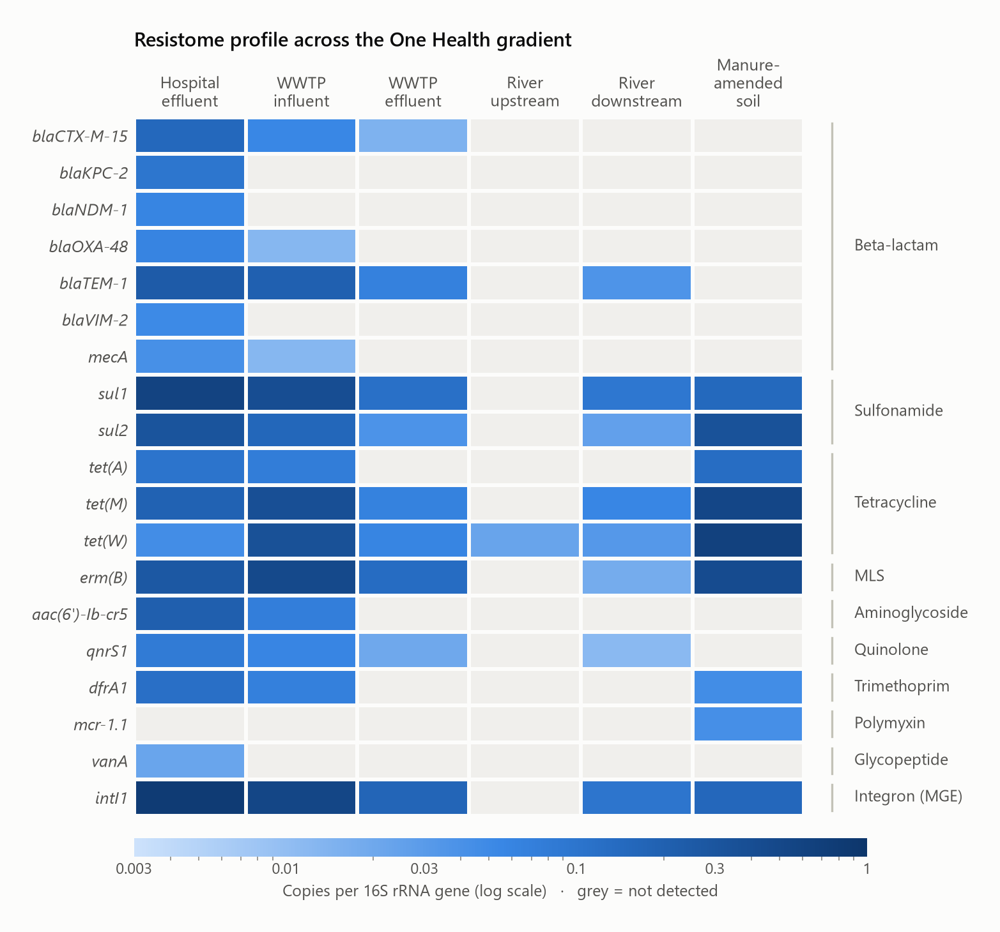
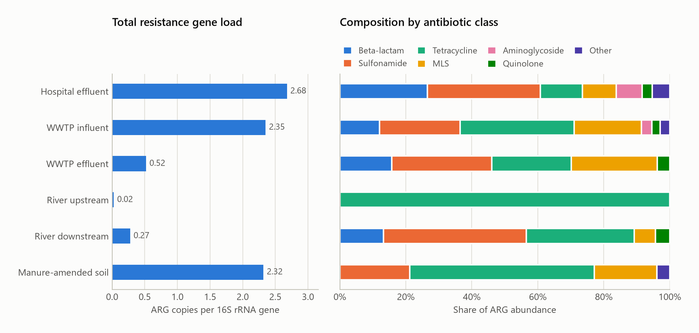
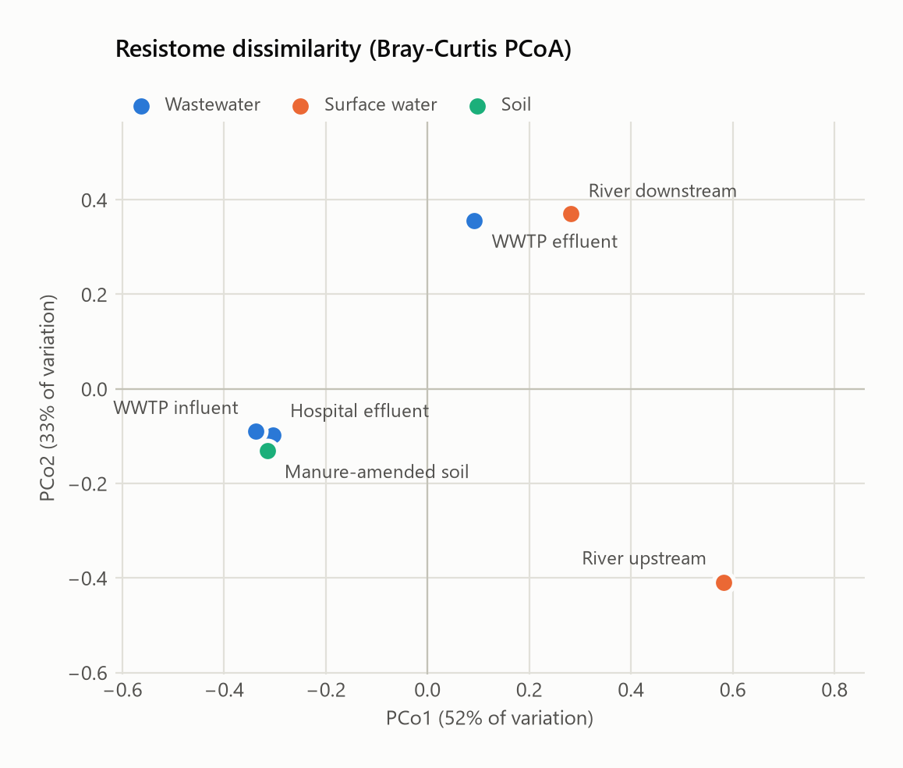
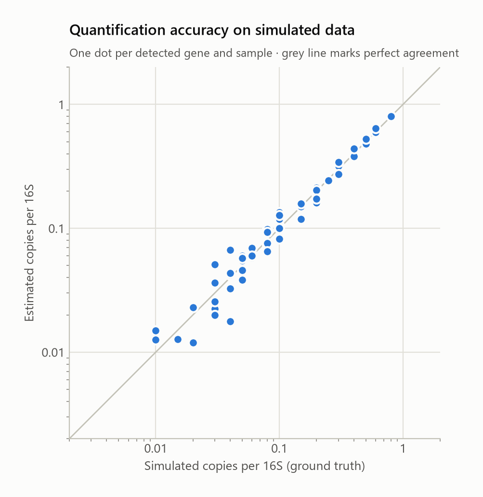

<div align="center">

# resistoscan

**Alignment-free surveillance of antimicrobial resistance genes, from the hospital to the river.**
A One Health bioinformatics pipeline in Python for clinical isolates and environmental metagenomes.

[](https://github.com/aespejolobo-rgb/resistoscan/actions/workflows/tests.yml)


**English** · [Español](README.es.md)

</div>

---

## Why this project

Antimicrobial resistance (AMR) was directly responsible for an estimated **1.27 million deaths in 2019**
(Murray *et al.*, *Lancet* 2022). Resistance genes do not stay in hospitals: they travel on plasmids and
integrons through hospital effluent, wastewater treatment plants (WWTPs), rivers and agricultural soils, where
they can be picked up again by human and animal pathogens. Tracking them across these compartments is the core
idea of the **One Health** approach, and wastewater metagenomics is now an established surveillance tool
(Hendriksen *et al.*, *Nat Commun* 2019).

`resistoscan` answers two practical questions with one engine:

| | **Clinical workflow** | **Environmental workflow** |
|---|---|---|
| Input | Assembled genomes of bacterial isolates (FASTA) | Shotgun metagenomic reads (FASTQ/FASTA, gz) |
| Question | *Which resistance genes does this isolate carry, where, and is it a priority pathogen genotype?* | *How abundant and diverse are resistance genes in this sample, and how do sites compare?* |
| Output | Gene calls with breadth, identity, SNP estimate, contig coordinates and strand; predicted resistant drug classes; alerts for carbapenemases, ESBLs, MRSA, VRE and *mcr* | Copies per 16S rRNA gene and RPKM per gene, alpha diversity, Bray-Curtis dissimilarity, PCoA, figures and a Markdown report |

## Highlights

- **Real reference data.** A curated panel of 18 clinically and environmentally relevant ARGs from the
  [NCBI Reference Gene Catalog](https://www.ncbi.nlm.nih.gov/pathogens/refgene/), plus the class 1 integron
  integrase *intI1* (a proxy for anthropogenic pollution) and the 16S rRNA gene for normalisation. The panel is
  rebuilt reproducibly with [`scripts/build_reference_panel.py`](scripts/build_reference_panel.py).
- **Alignment-free and fast.** Canonical 31-mers packed into 64-bit integers, a sorted-array index searched with
  vectorised binary search, and batch processing of reads: ~15,000 reads/s on one laptop CPU core with only
  NumPy, pandas and matplotlib.
- **Biologically meaningful outputs.** Abundances in copies per 16S rRNA gene (the standard unit in resistome
  studies), identity estimates from k-mer containment (Mash model), SNP counts, partial-gene flags and
  genotype-to-phenotype alerts.
- **Validated.** A built-in simulator generates a One Health dataset with known ground truth, and `resistoscan demo`
  benchmarks the pipeline against it. Detection, quantification and gene localisation are all scored.
- **Engineered like a real tool.** Installable package with a CLI, 22 unit and integration tests, continuous
  integration on GitHub Actions, typed and documented code.

## How it works



1. **Index**: every reference gene is cut into overlapping 31-mers. Each k-mer is stored in canonical form
   (the smaller of itself and its reverse complement), so matching does not depend on the sequenced strand.
2. **Reads**: each read is assigned to the gene sharing the most k-mers with it, if it shares at least 10 and they
   cover at least 25% of the matched span (≈ 95.6% nucleotide identity). Per-gene depth and breadth of coverage
   are accumulated, and genes are called when ≥ 50% of their length is covered.
3. **Assemblies**: the fraction of a gene's k-mers found in the contigs gives breadth of coverage and an identity
   estimate (identity ≈ containment<sup>1/k</sup>); missing k-mers give a SNP estimate; k-mer positions give
   contig coordinates and strand.
4. **Normalisation and ecology**: copies per 16S rRNA gene, RPKM, Shannon / Gini-Simpson / Pielou indices,
   Bray-Curtis dissimilarity and Principal Coordinates Analysis, all implemented from first principles.

The full derivations are in [docs/METHODS.md](docs/METHODS.md).

## Quick start

```bash
git clone https://github.com/aespejolobo-rgb/resistoscan.git
cd resistoscan
python -m venv .venv
source .venv/bin/activate        # Windows: .venv\Scripts\activate
pip install -e ".[dev]"

resistoscan demo -o demo         # simulate data, run both workflows, validate, write a report (~30 s)
pytest                           # run the test suite
```

The report is written to `demo/results/report.md`. A copy of a full run is in
[docs/example_report.md](docs/example_report.md).

## Results on a simulated One Health dataset

> **Note.** These results come from *simulated* data generated by `resistoscan simulate`: real reference genes,
> synthetic background genomes, Illumina-like 150 bp reads with 0.5% sequencing error. Abundances are illustrative
> orders of magnitude inspired by published trends, not measurements of real sites. Their purpose is to show what
> the pipeline recovers when the truth is known.

The scenario follows resistance genes along a wastewater pathway (hospital effluent → WWTP influent → WWTP
effluent → river downstream), with an upstream river as a reference site and a manure-amended agricultural soil
as a second, veterinary route.





<p align="center"></p>

What the pipeline recovers:

- **Hospital effluent** has the highest load (2.68 ARG copies per 16S) and is the only site where all four
  carbapenemase genes (*blaKPC-2*, *blaNDM-1*, *blaOXA-48*, *blaVIM-2*) are detected, together with *mecA* and *vanA*.
- **Wastewater treatment** lowers the total load about 4.5-fold (2.35 → 0.52), but *sul1*, *intI1*,
  tetracycline and macrolide genes persist in the effluent.
- **The river downstream** of the discharge carries about 12 times the load of the upstream site (0.27 vs 0.02)
  and clusters with the WWTP effluent in the ordination.
- **Manure-amended soil** has a tetracycline-dominated resistome and is the only site carrying *mcr-1*
  (mobile colistin resistance), pointing to the agricultural route.
- A **divergent OXA-48-like gene** (88% identity, like the chromosomal progenitors found in *Shewanella* spp.)
  in the upstream river is correctly **not** reported as the clinical *blaOXA-48* allele.

### Clinical isolates

| Isolate | Resistance genes detected | Alerts |
|---|---|---|
| *K. pneumoniae* ISO-01 | *aac(6')-Ib-cr5, blaCTX-M-15, blaKPC-2, blaTEM-1, dfrA1, qnrS1, sul1* | Carbapenemase (*blaKPC-2*, 1 SNP from reference); ESBL (*blaCTX-M-15*) |
| *S. aureus* ISO-02 | *mecA, tet(M)* | MRSA genotype |
| *E. faecium* ISO-03 | *erm(B), tet(M), vanA* | VRE genotype |
| *E. coli* ISO-04 | *blaCTX-M-15, mcr-1.1, sul2, tet(A)* | ESBL; mobile colistin resistance. Truncated *blaOXA-48* flagged as partial |

### Validation against the ground truth

<table>
<tr><td valign="top">

| Metagenomes | |
|---|---|
| Specificity | **1.00** (0 false positives in 44 absent pairs) |
| Sensitivity, genes ≥ 0.02 copies/16S | **0.93** |
| Sensitivity, all present genes | 0.84 (misses are at the detection limit) |
| Pearson *r*, log<sub>10</sub> abundance | **0.98** |
| Median fold error | **1.10** |
| Divergent decoy wrongly called | 0 / 1 |

| Isolates | |
|---|---|
| Precision / recall | **1.00 / 1.00** (17 genes) |
| Exact coordinates and strand | 17 / 17 |
| SNP count exact | 17 / 17 |
| Truncated gene flagged | 1 / 1 |

</td><td valign="top">



</td></tr>
</table>

## Using your own data

**Metagenomes**: a tab-separated sample sheet. Paths are relative to the sheet; paired files are comma-separated.

```text
sample      group          description        reads
HOSP_EFF    Wastewater     Hospital effluent  reads/hosp_R1.fastq.gz,reads/hosp_R2.fastq.gz
RIVER_UP    Surface water  River upstream     reads/river_up.fastq.gz
```

```bash
resistoscan metagenome samples.tsv -o results_metagenomes
```

**Isolates**: a sheet with one assembly per isolate.

```text
isolate     organism                assembly
KP-0231     Klebsiella pneumoniae   assemblies/KP-0231.fasta
```

```bash
resistoscan isolate isolates.tsv -o results_isolates
```

**Custom databases**: any nucleotide FASTA plus an annotation TSV with the columns `gene`, `category`
(`ARG`, `MGE` or `marker`) and `display_class` can replace the bundled panel:
`--db my_genes.fasta --metadata my_genes.tsv`. Run `resistoscan panel` to list the bundled genes.

| Output | Content |
|---|---|
| `gene_abundance.tsv` | Per sample and gene: reads, depth, breadth, identity, detection, RPKM, copies/16S |
| `abundance_matrix.tsv` | Samples × ARGs matrix (copies/16S) for downstream statistics |
| `alpha_diversity.tsv`, `bray_curtis.tsv`, `pcoa.tsv` | Ecological summaries |
| `isolate_genes.tsv`, `isolate_summary.tsv` | Gene calls with coordinates; predicted resistance and alerts |
| `figures/*.png`, `report.md` | Publication-style figures and a report that renders on GitHub |

## Reference panel

| Gene | Class | Why it matters |
|---|---|---|
| *blaKPC-2, blaNDM-1, blaOXA-48, blaVIM-2* | Beta-lactam (carbapenemases) | Carbapenem resistance in Enterobacterales, a WHO critical-priority threat |
| *blaCTX-M-15* | Beta-lactam (ESBL) | Most widespread extended-spectrum beta-lactamase |
| *blaTEM-1* | Beta-lactam | Common broad-spectrum beta-lactamase |
| *mecA* | Beta-lactam | Methicillin resistance in *S. aureus* (MRSA) |
| *vanA* | Glycopeptide | Vancomycin resistance in enterococci (VRE) |
| *mcr-1.1* | Polymyxin | Plasmid-borne colistin resistance, last-resort drug |
| *aac(6')-Ib-cr5* | Aminoglycoside / quinolone | Modifies both aminoglycosides and fluoroquinolones |
| *qnrS1* | Quinolone | Plasmid-mediated quinolone resistance |
| *sul1, sul2* | Sulfonamide | Among the most abundant ARGs in wastewater; *sul1* sits on class 1 integrons |
| *tet(M), tet(W), tet(A)* | Tetracycline | Dominant in livestock and manure-impacted environments |
| *erm(B)* | Macrolide-lincosamide-streptogramin B | Widespread in human and animal gut bacteria |
| *dfrA1* | Trimethoprim | Common integron gene cassette |
| *intI1* | Mobile genetic element | Class 1 integron integrase, proxy for anthropogenic pollution |
| 16S rRNA | Marker | Normalisation to bacterial genome equivalents |

Accessions, NCBI drug classes and lengths are listed in
[`src/resistoscan/data/amr_panel.tsv`](src/resistoscan/data/amr_panel.tsv).

## Design decisions and limitations

- **Exact k-mer matching is allele-specific.** Genes below ~95% nucleotide identity to a reference are not
  detected. That suits surveillance of known clinical alleles, but remote homologues need protein-level search
  (e.g. DIAMOND against CARD or the full NCBI database).
- **Curated panel.** 18 ARGs, in the spirit of high-throughput qPCR arrays. The engine accepts any database, but
  very redundant databases would benefit from an expectation-maximisation step to share multi-mapping reads
  (as in KMA), which is on the roadmap.
- **16S normalisation** uses one *E. coli* 16S sequence. Real communities need a 16S database (or single-copy
  marker genes) to count all taxa, and copy-number variation adds uncertainty.
- **Genotype is not phenotype.** Point mutations (e.g. *gyrA*, porin loss) and expression are not modelled.
  Predictions must be confirmed with antimicrobial susceptibility testing.
- **Simulated validation** shows correctness of the algorithms, not field performance. The next step is a real
  dataset such as public sewage metagenomes from the European Nucleotide Archive.

## Roadmap

- [ ] EM redistribution of multi-mapping reads for redundant databases (full NCBI / CARD)
- [ ] Single-copy marker genes as an alternative normalisation
- [ ] Case study on public wastewater metagenomes (ENA)
- [ ] Linking ARGs to plasmid or chromosomal context in assemblies
- [ ] Snakemake workflow and Docker image

## Project structure

```text
resistoscan/
├── src/resistoscan/
│   ├── kmers.py        # vectorised 2-bit canonical k-mer encoding
│   ├── index.py        # sorted-array k-mer index with batch lookup
│   ├── screen.py       # read assignment and assembly screening
│   ├── abundance.py    # RPKM and copies per 16S rRNA gene
│   ├── diversity.py    # Shannon, Simpson, Bray-Curtis, PCoA
│   ├── phenotype.py    # genotype-to-phenotype interpretation and alerts
│   ├── simulate.py     # One Health dataset with ground truth
│   ├── benchmark.py    # accuracy metrics against the truth
│   ├── plots.py        # figures
│   ├── report.py       # Markdown report
│   ├── pipeline.py     # workflows
│   ├── cli.py          # command-line interface
│   └── data/           # curated reference panel (FASTA + annotation)
├── scripts/build_reference_panel.py
├── tests/              # pytest suite
└── docs/               # methods, figures, example report
```

## References

1. Murray CJL *et al.* Global burden of bacterial antimicrobial resistance in 2019: a systematic analysis. *Lancet* 399:629–655 (2022).
2. Hendriksen RS *et al.* Global monitoring of antimicrobial resistance based on metagenomics analyses of urban sewage. *Nat Commun* 10:1124 (2019).
3. Feldgarden M *et al.* AMRFinderPlus and the Reference Gene Catalog facilitate examination of the genomic links among antimicrobial resistance, stress response, and virulence. *Sci Rep* 11:12728 (2021).
4. Gillings MR *et al.* Using the class 1 integron-integrase gene as a proxy for anthropogenic pollution. *ISME J* 9:1269–1279 (2015).
5. Ondov BD *et al.* Mash: fast genome and metagenome distance estimation using MinHash. *Genome Biol* 17:132 (2016).
6. Clausen PTLC, Aarestrup FM, Lund O. Rapid and precise alignment of raw reads against redundant databases with KMA. *BMC Bioinformatics* 19:307 (2018).
7. Yin X *et al.* ARGs-OAP v2.0 with an expanded SARG database and Hidden Markov Models for enhancement characterization and quantification of antibiotic resistance genes in environmental metagenomes. *Bioinformatics* 34:2263–2270 (2018).
8. Poirel L, Héritier C, Nordmann P. Chromosome-encoded Ambler class D β-lactamase of *Shewanella oneidensis* as a progenitor of carbapenem-hydrolyzing oxacillinase. *Antimicrob Agents Chemother* 48:348–351 (2004).
9. World Health Organization. *WHO Bacterial Priority Pathogens List 2024*.

## Author

**aespejolobo-rgb** · [GitHub](https://github.com/aespejolobo-rgb)

Released under the [MIT License](LICENSE). For research and education only; not for clinical diagnosis.
